<div align="center">

# Clawde 🦀

**A pixel-art desktop crab for Windows that stays on top of your windows and reacts to what [Claude Code](https://claude.com/claude-code) is doing.**

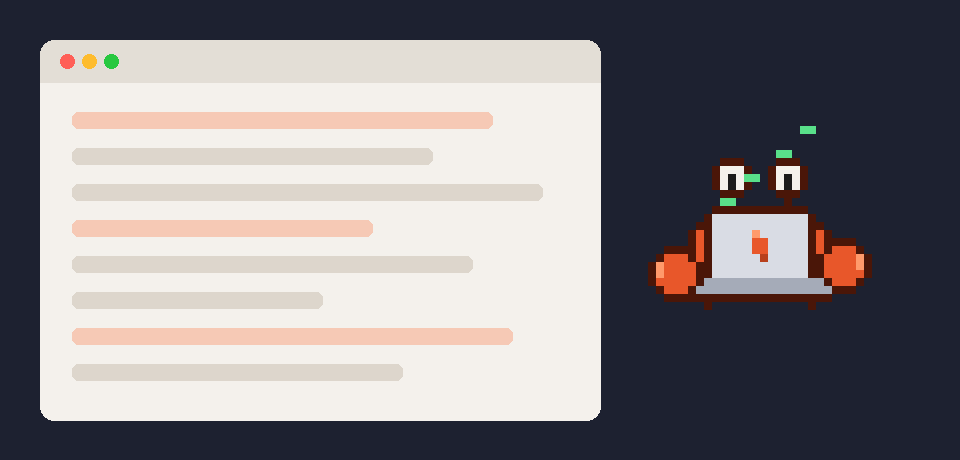

### [⬇️ Download the Windows installer](https://github.com/JaymeAlann/clawde/releases/latest)

</div>

---

## Contents

- [Features](#features)
- [Moods](#moods)
- [Requirements](#requirements)
- [Installation](#installation)
- [Using Clawde](#using-clawde)
- [Permission requests](#permission-requests)
- [Meeting notes](#meeting-notes)
- [Configuration](#configuration)
- [How it works](#how-it-works)
- [Troubleshooting](#troubleshooting)
- [Uninstalling](#uninstalling)
- [Development](#development)
- [Privacy](#privacy)
- [License](#license)

## Features

- 🪟 **Always on top.** Clawde floats above every app, browser and editor while you work.
- 🖱️ **Drag it anywhere.** Click and hold to carry it to any monitor (its legs dangle). It remembers where you dropped it.
- 🎲 **A mind of its own.** It idles, wanders around, looks around, waves, dances, blows bubbles and snaps its claws.
- 😴 **Naps.** After a few minutes with no keyboard or mouse input it falls asleep, and it wakes up happy when you come back.
- 🤩 **Gets excited when Claude is thinking.** Whenever *any* Claude Code session has just been given a prompt.
- 💻 **Pulls out a laptop when Claude is working.** Whenever *any* Claude Code session is running tools, on Windows or in WSL. It celebrates when the work is done.
- ✋ **Allow or Deny from the crab.** When any Claude Code session needs your permission, Clawde jumps up with the request and **Allow / Always allow / Deny** buttons, so you don't have to find the right terminal.
- 💡 **Offers help.** When it looks like you're stuck, Clawde pops up with a short tip from Claude.
- 🎙️ **Voice chat with Claude Code.** Hover the crab, press the microphone button, and talk.
- 🎧 **Meeting notes (optional).** When you join a Teams, Zoom, Meet, Slack or similar call, Clawde asks whether to record it. If you say yes, it transcribes the call on your PC and has Claude write a summary with decisions and action items.

## Moods

| Idle | Walking | Sleeping | Thinking | Working | Needs you |
| :---: | :---: | :---: | :---: | :---: | :---: |
| 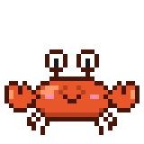 | 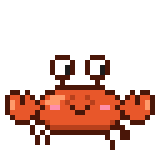 | 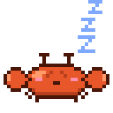 |  | 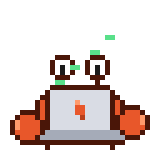 |  |
| Breathing, blinking | Wandering your screen | No input for 3 min | Claude got a prompt | Claude is running tools | Claude is waiting on you |

| Being dragged | Happy | Dancing | Bubbles | Has a tip | Recording |
| :---: | :---: | :---: | :---: | :---: | :---: |
| 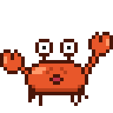 |  |  |  | 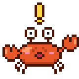 | 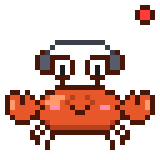 |
| Click and hold | Clicked, or Claude finished | Random | Random | Thinks you need help | Taking meeting notes |

All the poses on one sheet:

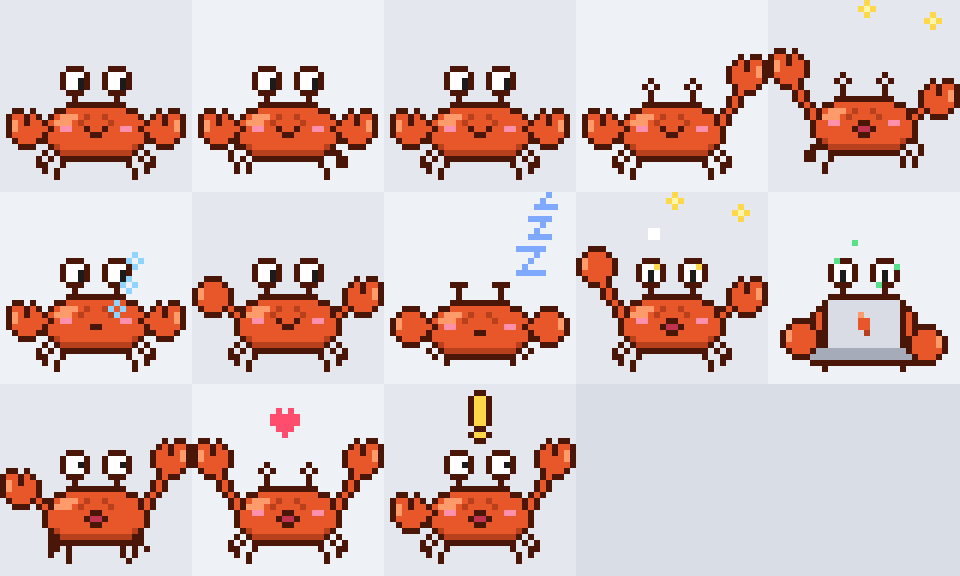

## Requirements

| | |
| --- | --- |
| **OS** | Windows 10 or 11 (64-bit) |
| **Claude Code** | Installed and logged in, either on Windows or inside WSL |
| **Python** | Only if you run from source: 3.9 or newer, with tkinter (the python.org installer includes it) |
| **Voice input** (optional) | Windows voice typing (Win+H), which is built into Windows 10/11 |
| **Meeting notes** (optional) | About 1 GB of disk space for the extra packages and the speech-recognition model |

The installer includes everything, meeting notes too. If you run from source, the crab itself only uses the Python standard library, and meeting notes need a few extra packages ([step 6](#6-optional-turn-on-meeting-notes)).

## Installation

### The easy way: installer

1. **[Install Claude Code](#2-install-claude-code-and-log-in)** and log in, if you haven't already.
2. Download **`Clawde-Setup-x.y.z.exe`** from the [latest release](https://github.com/JaymeAlann/clawde/releases/latest) and run it. No admin rights needed; it installs just for you.
3. Pick your options:
   - **Start Clawde when I sign in to Windows**
   - **Show Claude Code permission requests on Clawde**. This adds Clawde's hook to Claude Code's settings ([details](#permission-requests)).
   - **Create a desktop shortcut**
4. Clawde appears near the bottom-right of your screen. Done!

> **"Windows protected your PC"?** The installer isn't code-signed yet, so SmartScreen may warn about it. Click **More info → Run anyway**. You can check what it does in [`packaging/`](packaging/), and the installers are built in public by [GitHub Actions](.github/workflows/release.yml).

Clawde checks GitHub once a day and tells you when a new version is out.

### From source

If you'd rather run the Python code directly:

### 1. Install Python

Download it from [python.org](https://www.python.org/downloads/windows/) and tick **"Add python.exe to PATH"**, or install it with winget:

```powershell
winget install Python.Python.3.13
```

Check that it works (this should print `8.6`):

```powershell
py -c "import tkinter; print(tkinter.TkVersion)"
```

### 2. Install Claude Code and log in

Clawde talks to the `claude` command. You can install it on Windows, inside WSL, or both. Install it in just one of the following ways.

**On Windows (PowerShell):**

```powershell
irm https://claude.ai/install.ps1 | iex
```

**Inside WSL (Ubuntu):**

```bash
curl -fsSL https://claude.ai/install.sh | bash
```

Then run `claude` once in that same environment and log in. See the [Claude Code docs](https://docs.claude.com/en/docs/claude-code/setup) for other install options.

### 3. Get Clawde

```powershell
git clone https://github.com/JaymeAlann/clawde.git
cd clawde
```

You can also download the repository as a ZIP from GitHub and extract it.

### 4. Run it

```powershell
pyw crab_pet.py
```

Or double-click **`Start Clawde.bat`**. Clawde appears near the bottom-right corner of your main screen and says hi.

### 5. (Optional) Start Clawde when you log in

```powershell
powershell -ExecutionPolicy Bypass -File install_autostart.ps1
```

This adds a shortcut to your Windows Startup folder.

### 6. (Optional) Turn on meeting notes

```powershell
py -m pip install -r requirements-meetings.txt
```

This installs PyAudioWPatch (to record audio), numpy, and faster-whisper (speech recognition that runs on your PC). The first meeting you transcribe also downloads the Whisper speech model (about 460 MB for the default `small` model). Restart Clawde afterwards.

## Using Clawde

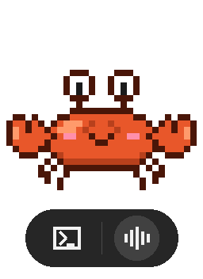

| Action | What happens |
| --- | --- |
| **Hover** over the crab | The menu appears underneath it, and hides again when you move away |
| **Terminal button** (left) | Opens a new Windows Terminal tab running `claude` |
| **Microphone button** (right) | Opens the chat window and starts voice typing. Talk, then pause: your message is sent to Claude Code automatically |
| **Click and hold** | Drag Clawde anywhere, across monitors |
| **Click** | Clawde is happy to see you (and wakes up if it was asleep) |
| **Click a speech bubble** | Opens the chat about that tip |
| **Right-click** | Menu: type to chat, open the CLI, record a meeting, open your meeting notes, turn features on/off, take a nap, quit |

**The chat window** keeps the conversation going until you press **New chat**. Each message is sent with `claude -p --resume <session>`, so Claude Code remembers what you said earlier. You can also type and press Enter instead of talking.

**When Clawde offers help:**

- The title of the window you're on contains words like *error*, *exception*, *traceback*, *failed*, *how to*, *404*... Clawde shows a ❗ and asks Claude's Haiku model for a short, specific tip.
- You're switching windows a lot. Clawde offers to help you find what you're looking for.
- You've been working for about an hour. Clawde reminds you to stretch.
- Every now and then, it shares a Claude Code tip.

It never shows more than one tip every 5 minutes, and stays quiet while it's asleep, being dragged, or recording a meeting.

<br clear="right">

## Permission requests

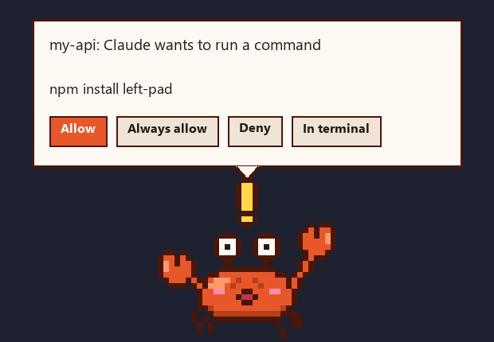

When any Claude Code session (in a terminal, in WSL, or in the Claude desktop app) wants to do something that needs your OK, Clawde jumps up, chimes, and shows the request:

| Button | What it does |
| --- | --- |
| **Allow** | Lets Claude do it this once |
| **Always allow** | Allows it and adds the rule Claude Code suggests (for example "allow `npm install` in this project"), so you won't be asked again |
| **Deny** | Blocks it. Claude is told you said no and carries on |
| **In terminal** | Hands the question back to Claude Code's own prompt |

If you don't answer within 60 seconds, the question goes back to Claude Code's own prompt, so nothing gets stuck. Several requests at once are queued, and the bubble shows how many are waiting. Clawde also gets your attention when Claude has finished and is waiting for you, or has a question.

**Connecting.** The installer can do this for you. Otherwise Clawde offers on first launch, or use **right-click → Permission requests → Connect to Claude Code**. This adds a small hook to `~/.claude/settings.json` on Windows and in WSL; a backup of your original file is saved as `settings.json.clawde-backup`. Sessions you start afterwards will use it. **Disconnect** removes the hook again.

**Modes** (right-click → Permission requests):

- **Ask me with Allow / Deny** (default): the bubble described above.
- **Just let me know**: Clawde tells you Claude needs you, and you answer in Claude Code.
- **Ignore them**: Clawde stays out of it.

**How it works.** Claude Code runs `clawde-hook` for its [`PermissionRequest` and `Notification` hooks](https://code.claude.com/docs/en/hooks). The hook drops the request into `~/.clawde/bridge` and waits for Clawde's answer there. Using a shared folder means it works the same for Windows, WSL and the desktop app, with no network ports. If Clawde isn't running, the hook gives up within 3 seconds and Claude Code asks you as usual.

## Meeting notes


1. **Clawde notices the call.** When a call app (Teams, Zoom, Webex, Slack, Discord, or a browser for Google Meet) starts using your microphone, Clawde perks up:

   > Looks like you're on a Teams call. Want me to record it and write up notes?
   > Remember to let everyone know it's being recorded.
   >
   > **[Record & take notes]** **[Not this time]**

   Nothing is recorded unless you click **Record & take notes**. If you click **Not this time**, Clawde won't ask again for that call.
2. **While it records,** Clawde wears headphones and shows a blinking red light. It records two tracks: your microphone ("You") and the call audio coming out of your speakers ("Others"). Click Clawde at any time to see how long it has been recording, or to stop.
3. **When the call ends** (the call app lets go of the microphone for 20 seconds), Clawde stops on its own. It then:
   - transcribes both tracks **on your PC** with [faster-whisper](https://github.com/SYSTRAN/faster-whisper),
   - sends the transcript to Claude Code (`claude -p`) to write the notes, and
   - shows a **"Your meeting notes are ready!"** bubble with buttons to open them.

To record something Clawde didn't detect, right-click Clawde and choose **Record a meeting now**, then **Stop recording and write notes** when you're done.

Each meeting gets its own folder in `Documents\Clawde Meetings` (for example `2026-10-23 1000 Teams`) containing:

| File | What's in it |
| --- | --- |
| `notes.md` | Title, summary, decisions, an action-item checklist with owners and due dates, open questions, key details |
| `transcript.md` | The full transcript with timestamps and You / Others labels |
| `meeting.json` | When it started, which app, and how long it lasted |
| `you.wav`, `others.wav` | The audio. Deleted once the notes are written, unless you set `keep_audio` to `true` |

See an [example of the notes](docs/example-notes.md) and [its transcript](docs/example-transcript.md), made from a short test meeting.

**Good to know**

- **Headphones work best.** Without them your microphone also picks up the other people. Clawde removes most of those echoes, but some lines may still be credited to "You".
- **Speakers aren't identified by name.** Everyone except you is "Others", but Claude uses names mentioned in the conversation when it assigns action items.
- **Speed.** On a typical laptop, the `small` model transcribes an hour of audio in roughly 5–15 minutes. For faster but less accurate results, set `whisper_model` to `base`. For better accuracy (slower), use `medium`.
- **Recording consent.** Many places require everyone on a call to agree to being recorded, and many workplaces have their own rules. Make sure you're allowed to record before you click Record.

<br clear="right">

## Configuration

Settings are saved in `%USERPROFILE%\.clawde\crab_config.json`. Most can be changed from the right-click menu; for the rest, edit the file and restart Clawde.

| Key | Default | Meaning |
| --- | --- | --- |
| `name` | `"Clawde"` | The crab's name, shown in bubbles and the chat window |
| `claude_mode` | `"auto"` | Which Claude Code CLI to use: `auto`, `windows` or `wsl`. `auto` uses `claude` on your Windows PATH if there is one, otherwise the one in WSL |
| `wsl_distro` | `"Ubuntu"` | The WSL distro to use for the CLI and to watch for activity |
| `workdir` | your home folder | The folder Claude Code starts in (Windows mode; WSL always starts in `~`) |
| `ai_tips` | `true` | Ask Claude for a tip when you look stuck. When off, Clawde shows a generic offer to help instead |
| `sleep_after_sec` | `180` | Seconds without input before Clawde naps |
| `walk` | `true` | Let Clawde wander around |
| `scale` | `0` | Size of one sprite pixel in screen pixels; `0` picks one from your display's DPI |
| `position` | `null` | Last place you dropped Clawde (saved automatically) |
| `meeting_notes` | `true` | Offer to record when a call starts (also in the right-click menu) |
| `meetings_folder` | `Documents\Clawde Meetings` | Where meeting folders are saved |
| `whisper_model` | `"small"` | Speech model: `tiny`, `base`, `small`, `medium` or `large-v3` (bigger = more accurate, slower) |
| `meeting_language` | `""` | Language code such as `"en"`, or blank to detect it automatically |
| `keep_audio` | `false` | Keep the WAV recordings after the notes are written |
| `approvals` | `"bubble"` | How to handle Claude Code permission requests: `bubble`, `notify` or `off` |
| `approval_wait_sec` | `60` | How long the Allow/Deny bubble waits before handing back to Claude Code (reconnect after changing it) |
| `sounds` | `true` | Chime when Claude needs you |
| `check_updates` | `true` | Check GitHub once a day for a new version |

## How it works

- **The window** is a borderless, always-on-top tkinter window. A colour key makes everything except the crab transparent and click-through.
- **Activity detection.** Clawde doesn't need any Claude Code hooks or settings changes. It watches the session transcripts that Claude Code already writes to `%USERPROFILE%\.claude\projects` and, through `\\wsl.localhost\<distro>\home\*\.claude\projects`, to WSL. If the newest entry in a session is a prompt, Clawde shows **thinking**. If it's a tool call or tool result, it shows **working**.
- **Idle and help detection** use the Win32 `GetLastInputInfo` and `GetForegroundWindow` functions through `ctypes`.
- **Voice input** focuses the chat box and presses Win+H to start Windows' own voice typing. Your audio goes through Windows, not through Clawde.
- **Chat and tips** run `claude -p --output-format json` in the background.
- **Call detection** reads Windows' microphone privacy tracking (`HKCU\...\CapabilityAccessManager\ConsentStore\microphone`), which records which app is using the mic right now.
- **Meeting recording** uses WASAPI through PyAudioWPatch: one stream from your default mic, and one "loopback" stream of your default speakers. Both are saved as 16 kHz mono WAV, padded with silence so the two tracks stay in sync.
- **Meeting processing** runs in a separate background Python process (`meetings.py process <folder>`), so Clawde stays responsive. You can also run that command yourself to process a folder again.

## Troubleshooting

| Problem | Fix |
| --- | --- |
| Clawde says it can't find Claude Code | Make sure `claude --version` works on Windows, or `wsl -d Ubuntu -e bash -lc "claude --version"` works in WSL. Set `claude_mode` and `wsl_distro` to match |
| Chat replies with "Failed to authenticate" | Run `claude` in a terminal in that environment and log in again |
| Clawde never shows the laptop | Check that your Claude Code transcripts are in `~/.claude/projects`. For WSL, set `wsl_distro` to your distro's name (`wsl -l`) |
| Voice typing doesn't start | Turn on voice typing in **Settings → Time & language → Speech**, or click the 🎤 button in the chat window |
| Clawde is too big or too small | Set `scale` (try `3` to `6`) |
| A console window appears | Start Clawde with `pyw`, not `py` |
| Clawde disappeared off-screen | Delete the `position` entry in `crab_config.json` and restart |
| SmartScreen blocks the installer | Click **More info → Run anyway** (the installer isn't code-signed yet) |
| No permission bubbles | Check **right-click → Permission requests** says *Disconnect* (meaning it's connected), then start a **new** Claude Code session. Sessions that were already open keep their old settings |
| Bubbles work on Windows but not in WSL | The installed hook runs the Windows `clawde-hook.exe` from WSL, which needs WSL's Windows interop (on by default) |
| Clawde says it needs extras to take meeting notes | Run `py -m pip install -r requirements-meetings.txt`, then restart Clawde |
| Clawde doesn't offer to record a call | Check **Offer to take meeting notes** in the right-click menu. If your call app isn't detected, use **Record a meeting now** |
| The "Others" track is silent | Clawde records your *default* speakers. Make the device your call plays through the default in Windows sound settings |
| Notes failed but the transcript is there | Claude Code wasn't reachable. Run `py meetings.py process "<meeting folder>"` to try again |

## Uninstalling

**Installed with the installer:** open **Settings → Apps → Installed apps**, find **Clawde** and choose **Uninstall**. This also removes the Claude Code hook and the login shortcut. Your settings and meeting notes are kept; delete `%USERPROFILE%\.clawde` and `Documents\Clawde Meetings` if you want those gone too.

**Running from source:**

1. Right-click Clawde and choose **Permission requests → Disconnect from Claude Code**, then **Goodbye**.
2. Remove the login shortcut, if you added it:

   ```powershell
   powershell -ExecutionPolicy Bypass -File install_autostart.ps1 -Uninstall
   ```

3. Delete the folder.

## Development

```text
crab_pet.py              the app: sprite renderer, behaviour, activity watcher, chat
claude_link.py           adds/removes the Claude Code hook, answers permission requests
clawde_hook.py           the hook Claude Code runs (standard library only)
meetings.py              call detection, recording, transcription, and the notes prompt
requirements-meetings.txt  extras for meeting notes
packaging/               icon, PyInstaller + Inno Setup build (build.ps1, clawde.iss)
.github/workflows/       builds the installer for each release
install_autostart.ps1    adds or removes the login shortcut (source installs)
Start Clawde.bat         double-click launcher
tools/make_docs_images.py  regenerates the images in docs/
docs/                    README images
```

The sprite is drawn in code on a 32×32 grid (see `render()` and `pose_params()`), so there are no image assets to edit. To add a pose, add a branch in `pose_params()`, then preview it:

```powershell
py crab_pet.py --preview poses.png
```

### Building the installer

```powershell
py -m pip install -r requirements-meetings.txt pyinstaller pillow
winget install JRSoftware.InnoSetup
powershell -ExecutionPolicy Bypass -File packaging\build.ps1
```

The installer lands in `build\installer\`.

### Releasing

1. Bump `__version__` in `crab_pet.py`.
2. Commit, then tag and push: `git tag v0.2.0` then `git push origin v0.2.0`.
3. GitHub Actions builds `Clawde-Setup-<version>.exe` and attaches it to a new release. Installed copies of Clawde will offer the update within a day.

### README images

To regenerate the README images (this needs Pillow, for docs only):

```powershell
py -m pip install Pillow
py tools/make_docs_images.py
```

## Privacy

- Clawde reads your Claude Code transcript files **locally**, only to tell whether a session is busy. Their contents never leave your machine.
- With `ai_tips` on, the **title of your active window** is sent to Claude when it looks like you need help. Window titles can contain email subjects, document names or URLs. Turn this off from the right-click menu, or set `"ai_tips": false`.
- Chat messages go to Claude Code, exactly as if you'd typed them into `claude`.
- **Permission requests** pass between Claude Code and Clawde only through files in `~/.clawde/bridge` on your PC, and are deleted once answered. Clawde opens no network ports.
- The once-a-day update check asks GitHub for the latest release number and sends nothing about you. Set `check_updates` to `false` to turn it off.
- **Meetings are only recorded after you click Record.** The audio never leaves your PC: transcription runs locally, and the recordings are deleted after the notes are written (unless `keep_audio` is on). The **transcript text** is sent to Claude to write the notes. Transcripts and notes stay in your meetings folder.

## License

[MIT](LICENSE)
